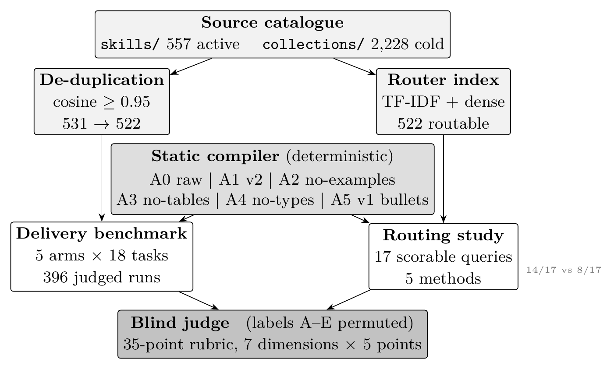

# Measuring the Floor Before Claiming the Null: Agent Skill-File Delivery Formats in an LLM-Judged Coding Benchmark

## Abstract

A report of "no significant difference" in an LLM-judged software engineering benchmark is uninterpretable unless the reader knows what the instrument could have detected. We make the measurement floor the primary result rather than an appendix. On an 18-task benchmark we compare five agent skill-file delivery formats spanning 0–70.8% token reduction across 396 blind judged runs, under a protocol that permutes arms across judging slots specifically so that position effects can be measured rather than assumed away. Delivery format did not measurably change output quality: the full five-arm range is 0.68 points on a 35-point rubric. We report this as **detection-limited, not as equivalence**. The test–retest floor, pooled within-cell across all 396 runs, is $\sigma = 5.37$; against the task-blocked design actually used ($\sigma_d = 3.76$ over 17 task pairs) the minimum detectable effect at 80% power is 2.72 points, so the observed 0.27-point gap is 10.1% of that threshold and resolving it would require roughly 1,500 task pairs.

We also report what we could not reproduce — including an error we introduced ourselves while correcting an earlier one. An earlier draft of this work quoted a noise floor of $\sigma = 6.09$ from "42 runs on byte-identical prompts" and a paired standard deviation over "78 pairs." No run subset of size 42 exists in our archive, and no code produced any of the three figures. Recomputing them from the raw runs changed every one. Our first correction then introduced a second error, applying the two-sample MDE formula to a paired design and overstating the threshold by a factor of $\sqrt{2}$; we report that too. The corrected floor is $\sigma = 5.37$, and the corrected detection threshold is **2.72 points** by the exact noncentral-$t$ calculation (2.55 by the normal approximation, which is 6.5% lower at $n = 17$). The observed gap of 0.27 is 10.1% of the exact threshold, or 10.7% of the normal approximation. We report 2.72 throughout and the approximation only where the two differ materially. The conclusion did not change, but it is now correct rather than merely flattering.

We further withdraw three earlier claims, quantify a judge slot-position bias of $+3.66$ points (13× the task-paired treatment effect), confirmed under a within-window permutation test that treats the judging window as a block, and state that our rubric's relationship to executable correctness is unestablished at this scale (pooled $r = +0.047$, $p = 0.473$). Every headline number is recomputed from the archived runs by released code, and the two errors above were found by applying to our own statistics the scrutiny we are asking of others.

**Keywords:** Reproducibility, Negative Results, Measurement Validity, LLM-as-a-Judge, Software Engineering Benchmarks, Agent Skills, Context Engineering.

---

## 1. Introduction

Agent skill files are Markdown documents loaded into a coding agent's context. They carry API conventions, architectural invariants, testing patterns, and procedural guidance. A well-written one runs to thousands of tokens, and a team configuring twenty of them pays that cost on every single turn.

The practitioner response is compression. The problem is that nobody has established what compression is safe. The folklore splits cleanly:

- **Compress the prose.** Verbose instructions are padding; strip them and nothing is lost.
- **Keep the syntax.** Code fixtures and type signatures are load-bearing; delete them and the agent breaks.

Both halves sound plausible. Neither has been tested against a floor. Papers that compare prompt formats typically report a mean difference and a $p$-value, without reporting whether the instrument could have detected an effect that mattered. A difference of 0.2 points on a 35-point rubric is reported as "no significant difference," which conflates *we found nothing* with *we could not have found anything*. Software engineering has a long history of this failure mode — reported effects that vanish under replication, and benchmarks whose difficulty is confounded with the treatment being studied. The field's response has been to call for replications and for reported measurement validity; what has been harder is the ordinary, unglamorous work of computing one's own detection threshold before interpreting a $p$-value.

This paper does that ordinary work, and reports the results whether or not they flatter the hypothesis. We ask three questions:

1. **RQ1 — Delivery format.** Across five delivery strategies spanning 0% to 70.8% token reduction, does any measurably change output quality?
2. **RQ2 — Component sensitivity.** Which structural components (examples, tables, types) account for any difference, measured against a test–retest noise floor rather than against zero?
3. **RQ3 — Retrieval.** At catalogue scale, is a routing layer better than a tuned lexical baseline or than passing the whole catalogue in context?

Our headline answer to RQ1 is that nothing separates the arms, and that this is a statement about measurement power rather than about compression. We make the power calculation the contribution rather than an appendix.

**This is a negative-results paper, and we treat that as a feature rather than a consolation.** Two things make it useful beyond the specific comparison. First, we publish the floor itself — $\sigma$, the implied MDE, and the required sample size — so that a reader reporting on a comparable instrument can calibrate their own claims against it. Second, and less comfortably, we report the points where we could not reproduce our own earlier work, including the headline power analysis of a previous draft of this very manuscript (§7).

**What kind of null this is, and why we think it is worth reporting.** A negative result can fail to be informative in two distinct ways, and they call for different remedies. The uninformative case is *absence of power*: a design too weak to see effects that were there, which resolves only by collecting more data. The informative case is *a measured limit on what the instrument can resolve*, established before the comparison is read — which resolves by reporting the limit. This paper is the second kind, and we can point to the evidence that distinguishes them. First, we report a **positive control**: one intervention in this same benchmark — aggressive bulletization — moved Testing & QA by $-6.32$ points, above the floor we measured. The instrument did fire, on this corpus, on this rubric; it was not simply blind. That is what separates our result from the "we would have seen it if it were there" family. Second, the floor is not a post-hoc rationalisation. It is computed from the within-cell variation of byte-identical prompts, and it is recomputed by released code that a reader can run. Third, we state what the design would need — roughly 1,500 task pairs rather than 17 — which converts an uninformative null into a priced one: the reader learns both that the question is open and what closing it costs.

We are explicit about the limit of this position. We have shown the benchmark cannot distinguish these arms from one another; we have not shown they are equivalent, and nothing here licenses a practitioner to conclude that any particular compression ratio is safe for their corpus.


---

## 2. Background and Objectives

### 2.1 Skill files as a delivery format

A skill file is a Markdown document with frontmatter metadata and a prose body. It may contain structural metadata defining invocation triggers, imperative standards specifying concurrency or security invariants, or syntactic anchors providing concrete interface contracts. These enter the model's context either wholesale, by retrieval, or by deterministic compilation into a reduced form.

Three properties are commonly asserted about such files and rarely measured:

- **Token overhead.** How many tokens does the format itself cost?
- **Structural necessity.** Which body components carry the signal?
- **Retrieval value.** Does fetching a small subset beat supplying everything?

### 2.2 Why a null needs a floor

A conventional comparison reports $\bar{x}_1 - \bar{x}_2$ and a significance test. If the test returns $p > 0.05$, the standard reading is "no difference." That reading is wrong whenever the instrument lacks power to resolve a difference that would matter.

The minimum detectable effect for a paired design at significance $\alpha$ and power $1-\beta$ is

$$\text{MDE} = (z_{1-\alpha/2} + z_{1-\beta}) \cdot \frac{\sigma_d}{\sqrt{n}}$$

where $\sigma_d$ is the standard deviation of paired differences and $n$ the number of pairs. The denominator is $\sqrt{n}$ and not $\sqrt{2/n}$: the factor $\sqrt{2}$ belongs to the standard error of a difference between two *independent* means, whereas a paired test already conditions on the task and has standard error $\sigma_d/\sqrt{n}$. Because this benchmark blocks on task, the pairing unit is the task, not the individual run.

Equation (1) treats $\sigma_d$ as known. With only $n-1 = 16$ degrees of freedom it is not, and the exact threshold is somewhat larger. Solving the noncentral $t$ distribution for the same $\alpha$ and power gives a minimum detectable effect of $2.72$ points, about 6.5% above the normal approximation. **We report the exact value throughout** and use the normal approximation only where it is convenient, reporting the shortfall whenever the two differ materially.

We therefore report $\sigma$ (the test–retest floor), the MDE it implies, and the observed effect as a fraction of it. The observed task-blocked gap of 0.27 points is 10.1% of the threshold — not a finding of equivalence, but a finding that the question is below the resolution of a 396-run benchmark.

All four quantities in this section are recomputed by `scripts/verify_noise_floor.py` and pinned by `tests/test_noise_floor.py`. We state the definitions explicitly because they were previously implicit, and because a noise floor quoted without its estimator is not a measurement.

### 2.3 Objectives

1. Quantify the test–retest noise floor for a blind LLM-judged coding benchmark.
2. Evaluate five delivery strategies against that floor.
3. Decompose structural component sensitivity (examples, tables, types) against the same floor.
4. Characterize the judge's systematic error sources independently of the treatments.
5. Measure retrieval against a lexical baseline and against in-context catalogue delivery.

---

## 3. Related Work

### 3.1 Prompt construction in software engineering

Empirical work on prompt construction is substantial. Khojah et al. (IEEE TSE 2025) evaluated 7,072 prompts across five prompt-programming techniques on function-level generation. Schäfer et al. (IEEE TSE 2024) developed TestPilot for automated unit-test generation. Fakhoury et al. (IEEE TSE 2024) examined test-driven interactive generation with a user study. Liao et al. (IEEE TSE 2024) presented A3-CodGen for repository-level reuse. Surveys by Hou et al. (ACM TOSEM 2024) and Du et al. (IEEE Software 2024) synthesize the field.

### 3.2 Context mechanics

Liu et al. (TACL 2023) established the "Lost in the Middle" phenomenon: models attend most reliably to the beginning and end of long contexts. This motivates compression but does not establish which components of a document are recoverable.

### 3.3 Agent skills as a format

Destefanis et al. (arXiv 2026) released GitSkills, a dataset of agent skills harvested from GitHub, confirming that the format has become widespread enough to mine. NVIDIA's ACES (arXiv 2026) addresses continuous evaluation of skills specifically. We build on both: the former supplies the catalogue population, the latter the evaluation framing.

### 3.4 LLM-as-judge reliability

Checklist-based judging is established (Cook et al. 2024; Zhou and Tan, ACL 2026), as is fine-grained verifier feedback (Kwok et al. 2026). Reliability limits are known: Kong et al. (arXiv 2026) document the lifecycle of LLM-as-judge for large-scale recommendation explanations. Our contribution is not to discover judge unreliability in general but to quantify one specific, measurable systematic error — slot-position bias — inside a software-engineering coding benchmark, and to show that correcting for it leaves conclusions unchanged.

### 3.5 Reproducibility and statistical power in software engineering

The methodological posture of this paper is not new, and we do not claim it as such. Mann, Keeling and Ioannidis (CACM 2019) showed that a large fraction of published computer science results fail to replicate; Bailey et al. (FSE 2019) narrowed that finding to software engineering specifically, where replication rates for accepted papers have repeatedly been measured well below the field's own standards of proof. Artzi et al. (FSE 2011) established that empirical SE conclusions are unusually sensitive to study design, and Briand et al. (ESEM 1999) demonstrated that conclusions drawn from software quality metrics can reverse under a different evaluation design.

What these threads share with our work is the insistence that an empirical SE claim is only as strong as its stated measurement power, and that a reported effect unsupported by the evidence presented is not a finding. What they generally do not — and what §5.1 and §7 add here — is publish the *detection threshold itself* as a reusable artefact alongside the raw runs, and then apply the reproducibility audit to the authors' own prior claims. We treat the reproducibility of our own reported statistics as a result subject to the same scrutiny as any other claim in this paper, and §7 reports where it failed.

---

## 4. Method

### 4.1 Architecture

The architecture is summarised in Fig. 1.


*Figure 1: Benchmark and study architecture. The catalogue is de-duplicated and indexed; every delivery arm is compiled deterministically before the blind judge scores all arms of a task in one permuted window.*


### 4.2 Delivery strategies

Five arms span the compression range:

| Arm | Description | Reduction |
| :--- | :--- | ---: |
| `control` | Base task prompt, zero skill content | 0.0% |
| `full` | Verbatim human-authored `SKILL.md` | 0.0% |
| `retrieved` | `SKILL.md` segmented into hierarchical chunks | 0.0% (selection differs) |
| `checklist_v2` | Structure-preserving static compilation | 28.6% |
| `checklist` | Aggressive rule bulletization (the \`v1\` compiler mode) | 70.8% |

`control` and `full` share a token count but differ in content: `control` injects nothing, `full` injects the entire manual. `retrieved` selects a subset of `full` under the same token budget.

### 4.3 Blind protocol and position balancing

Delivery arms are permuted across labels A–E before judging, so the judge cannot infer the treatment from label position. The protocol schedules up to 5 runs per task–arm cell across 18 tasks and 5 arms, which is 450 planned instances. Attrition is itemised below so that every planned run is accounted for: 25 are lost with the dropped task, and a further 29 to failed or unrecorded generations, leaving 396 judged.

| Arm | Planned | Judged | Unaccounted |
| :--- | ---: | ---: | ---: |
| `control` | 85 | 79 | 6 |
| `full` | 85 | 78 | 7 |
| `retrieved` | 85 | 79 | 6 |
| `checklist` | 85 | 80 | 5 |
| `checklist_v2` | 85 | 80 | 5 |
| **Total (17 tasks)** | **425** | **396** | **29** |

Every denominator in this paper traces to one chain. The protocol scheduled 18 tasks × 5 arms × 5 runs = **450** generation attempts, and the archive holds exactly 450 response files under `raw_outputs_ieee/`. Of those, 25 belong to `db-ratelimit-redis-ieee` (5 arms × 5 runs): that task *was* generated and its responses are retained, but it was never judged, so it contributes no scores and no task-blocked pair. That leaves **425** scheduled attempts across the 17 judged tasks, of which **396** produced a judged record and **29** did not. The same arithmetic per arm gives 90 files, less 5 from the dropped task, equals 85 scheduled, less the judged count, equals the per-arm unaccounted column above.

So the 450 is a generation count, the 425 is a scheduling count, and the 396 is a judged count; they differ by exactly the 25 dropped-task responses and the 29 unaccounted outcomes.

Attrition here has **two** causes, and an earlier draft of this section got both wrong in opposite directions. Recomputing file lengths by run index rather than by list position gives this account.

Of the 54 lost attempts, **48 are executor failures** — a retained file that is a 23-character record of the form `[exit=5 latency=1.67s]`, meaning the executor terminated with a non-zero status in under two seconds. All 25 attempts on the dropped task are of this kind, deterministically across every arm, which is why we drop the task rather than its individual runs; the other 23 are scattered across the remaining 17 tasks. **Six further attempts generated a full-length response** (19.7k to 36.0k characters) and have no judged record, so for those the loss occurred downstream, in judging or in persisting the record; the runner logged only completed judgments, so we cannot separate the two and do not guess.

An earlier draft described all 29 of the scattered losses as “median 17.7k to 28.4k characters”, concluding generation had succeeded throughout. That was wrong because the lengths were read by list position instead of run index. A subsequent over-correction described all 54 as 23-character stubs; that was wrong too, because it generalised from the median and missed the six full-length responses. Both errors are recorded here because the corrected split — 23 short and 6 long among the scattered losses — is what the truncation analysis in §8.4 depends on.

The arithmetic closes exactly: of 425 retained files, 348 exceed the judging cap and 77 do not; of the 396 judgments, 342 come from truncated responses and 54 from responses under the cap, leaving exactly 6 truncated and 23 untruncated files unaccounted for.

Slot occupancy is held near-balanced (11–20 runs per arm–slot cell) so position bias averages into noise rather than confounding an arm with a slot.

Catalogue figures throughout this paper describe the corpus **as it stood when the benchmark ran**, pinned by the manifest recorded in `benchmarks/checklists_v2/manifest.json` and the 522-skill catalogue recorded in `benchmarks/router_level1_results.json`. The warehouse has since grown (the repository now holds more active skills and more cold-storage playbooks than at run time). We quote the run-time counts so that the numbers remain comparable with the archived results, and we do not silently substitute present-day counts into a completed experiment.

### 4.4 Rubric

A 35-point rubric scores seven dimensions at 5 points each: correctness, completeness, maintainability, architecture, security, reasoning quality, and instruction adherence. Judging is performed by a single model (`deepseek/deepseek-v4-pro`) blind to condition. Generation uses `qwen/qwen3.7-flash`.

### 4.5 Compiler and reproducibility

The compiler is a byte-for-byte Python implementation cross-validated against a prior Rust implementation across all six compilation modes for every benchmark skill: **120/120 byte-identical**. Both compiled arms regenerate 18/18 artifacts against manifests recorded at run time, verified in CI on every commit. A recovered source is accepted only when its SHA-256 equals the hash the manifest recorded, never merely because it recompiles.

### 4.6 How token counts were measured

All token figures in this paper are measured with a byte-pair-encoding tokenizer (`cl100k_base`), not with a character heuristic.

This distinction is not cosmetic. An earlier version of this work computed the compression figure with `estimate_tokens() == len(text) // 4`, a character heuristic. Re-measuring the same files with a real tokenizer gives:

| Method | Source | Compiled | Reduction |
| :--- | ---: | ---: | ---: |
| `len//4` heuristic | 38,511 | 26,801 | 30.41% |
| `cl100k_base` | 37,272 | 26,627 | **28.56%** |
| `o200k_base` | 37,259 | 26,652 | 28.47% |
| `p50k_base` | 45,378 | 32,197 | 29.05% |

The heuristic overstates the reduction by 1.85 percentage points. Across three tokenizers the figure varies by 0.58 pp, so the compression itself is stable; it is the estimator that was wrong. We report the `cl100k_base` value throughout and check it in CI (`scripts/measure_tokens_real.py --check`), which fails if a source drifts from its recorded manifest hash or if the reduction moves by more than 0.5 pp.

Per-skill this is a mean over the 18 benchmark skills: 2,071 source tokens to 1,479 compiled tokens, a saving of 591 tokens per skill per turn.


---

## 5. Results

### 5.1 The noise floor

Every run inside a given task–arm cell was produced from a byte-identical prompt. Pooling the within-cell variation across all 396 runs therefore isolates judge and generation stochasticity from any treatment effect:

$$\sigma = 5.37 \text{ points}$$

computed as the pooled within-cell standard deviation over 85 cells with 311 degrees of freedom, with per-cell standard deviations ranging 0.00–11.73. This is the instrument's resolution limit, and it is recomputed — not asserted — by `scripts/verify_noise_floor.py`.

Against the task-blocked paired design actually used in §5.2 ($\sigma_d = 3.76$ over 17 task pairs), the minimum detectable effect is

$$\text{MDE} \approx 2.72 \text{ points} \quad (7.8\% \text{ of the scale})$$

at 80% power and $\alpha = 0.05$. Every "no significant difference" reported below should be read as *below the detection threshold*, not as evidence of equivalence.

**These figures replaced an earlier draft's $\sigma = 6.09$, $\sigma_d = 7.87$, and MDE of 2.53, none of which could be reproduced from the archive.** The failure, its diagnosis, and its effect on the conclusion are the subject of §7; we state the corrected values here so that §5 can be read on its own.

### 5.2 RQ1: Delivery format does not measurably change quality

Across all domains:

| Arm | Mean | n |
| :--- | ---: | ---: |
| `full` | 25.17 | 78 |
| `checklist_v2` | 24.96 | 80 |
| `retrieved` | 24.73 | 79 |
| `checklist` | 24.54 | 80 |
| `control` | 24.49 | 79 |

Figure \ref{fig:arms} shows all five arm means with 95% confidence
intervals against the detection threshold. The full range across five
strategies is **0.68 points**. The difference of arm means between `full` and `checklist_v2` is $+0.204$; because the design blocks on task, the paired statistic is computed on per-task mean differences, giving a mean paired difference of $+0.275$ with $t = 0.30$, $p = 0.7672$ over 17 task pairs. That observed difference is **10.1% of the MDE**. (An earlier draft paired the $t$ with the unpaired $+0.204$; the two quantities answer different questions and we now report both.)


```figure
fig_arms.pdf | fig:arms | Per-arm mean rubric scores with 95% confidence intervals. The shaded span has the width of the minimum detectable difference at 80% power; the observed spread across all five arms is 25% of it.
```
No arm significantly exceeds `control` under any comparison (all Welch $p > 0.6$).

**This is the paper's central negative result, and it is explicitly detection-limited.** A true effect of the size we observed cannot be resolved by this design. We do not claim arms are equivalent; we claim the benchmark cannot distinguish them.

### 5.3 The one component that clears the floor

Aggressive bulletization (the `checklist` arm, 70.8% compression) is the single intervention that clears the noise floor:

| Domain | `full` | `checklist` | $\Delta$ |
| :--- | ---: | ---: | ---: |
| Testing & QA | 23.50 | 17.18 | $-6.32$ |

We flag this as **marginal**: $n = 11$ pairs, and the effect sits at roughly one noise-floor unit. It is consistent with the folklore intuition that aggressive extraction damages tasks whose guidance depends on concrete syntactic fixtures, but it does not meet a replication standard on its own. We report it as a hypothesis requiring confirmation rather than a finding.

The milder `checklist_v2` arm (28.6% compression) does not show this drop, which constrains any mechanism claim: it is not compression *per se* that harms these tasks, but compression aggressive enough to remove syntactic anchors.

### 5.4 Component ablations

Structured ablations removed examples (A2), tables (A3), and types (A4) independently:

| Arm | Mean across tasks | n tasks |
| :--- | ---: | ---: |
| A1 v2 balanced (reference) | 19.75 | 4 |
| A2 no examples | 18.58 | 6 |
| A3 no tables | 16.83 | 6 |
| A4 no types | 21.50 | 6 |

Ten of twelve true interventions move scores by at most $\pm 6$ points — within the noise floor. Notably, **A4 (no types) scores highest**, which is inconsistent with any simple "syntax carries the signal" account. We report this without a mechanism, since the cells are small ($n = 3$) and heterogeneous.

### 5.5 Replicate failure we report rather than bury

An earlier version of this manuscript reported a syntax-collapse effect: stripping TDD tracer-bullet code from a `tdd` skill reduced a payment-state-machine task by $\Delta = -8.50$ at $n = 6$, and we characterised it as replicated. We re-ran that cell at $n = 15$ per arm with a matched control:

| Arm | n | Mean | SD |
| :--- | ---: | ---: | ---: |
| `a1_v2_balanced` | 15 | 22.53 | 5.11 |
| `a2_no_examples` | 15 | 26.07 | 7.37 |

The effect **reverses**: $\Delta = -3.53$, Welch $t = -1.525$, $p = 0.14$. The pooled SD (6.34) reproduces the noise floor closely, so the instrument behaved as documented — the effect did not.

We withdraw the syntax-collapse claim. The original runs show workspace leakage consistent with the confound we disclose in §8, but we cannot determine whether the original cell was erroneous or the conditions drifted. The honest statement is that we could not replicate it, and the syntax component remains an open question.

### 5.6 Position bias is 13× the treatment effect

The blind protocol permutes arms across labels A–E, yet the judge exhibits a strong slot preference:

| Slot | Deviation from grand mean | n |
| :--- | ---: | ---: |
| A | $+2.08$ | 78 |
| B | $+0.70$ | 80 |
| C | $-0.79$ | 80 |
| D | $-1.58$ | 80 |
| E | $-0.37$ | 78 |

**These scores are clustered, and the obvious test is the wrong one.** The blind protocol scores all five arms of a task inside one judging window, so the 396 rows are not independent observations: five of them share a task, a judge call, and that window's idiosyncrasy. A one-way ANOVA or Kruskal–Wallis over the pooled rows ignores that dependence and understates the standard error. An earlier draft of this section reported exactly that — $F = 4.5373$, $p = 0.00136$ — and we withdraw the statistic.

Treating the window as the block gives a *stronger* result, not a weaker one. Removing each window's own mean, and building the reference distribution by permuting position labels **within** each window — the randomisation the protocol actually performed — we obtain

| Analysis | Statistic | $p$ |
| :--- | ---: | ---: |
| Pooled ANOVA (independent rows; **withdrawn**) | $F = 4.5373$ | 0.00136 |
| ANOVA on window-centred scores (descriptive only; see text) | $F = 7.1794$ | 0.000014 |
| Permutation of labels within windows (20{,}000 draws) | spread $= 3.63$ | $< 0.00005$ |
| Sign test, slot A vs slot D, one-sided (52 of 73 windows) | --- | 0.000186 |
Table: tab:posbias | Position bias under four analyses. The pooled ANOVA treats clustered rows as independent and is withdrawn; the centred ANOVA is descriptive only. The within-window permutation is the inferential result.

**We rely on the permutation test alone, and we withdraw the ANOVA's significance claim.** Centring removes between-window variance but does *not* make the five residuals inside a window independent of one another — they are constrained to sum to zero within their own window, which is precisely the dependence the block was introduced to model. The centred ANOVA is therefore reported only as a descriptive contrast and its $p$-value should not be read as a valid significance test under the clustered design. The within-window permutation is the inferential claim: it is exact under the randomisation the protocol actually performed, it respects the clustering by construction because labels are only ever shuffled *within* a block, and it assumes nothing about the score distribution. It is the only test in Table~\ref{tab:posbias} we ask readers to rely on.

A sign test on the same contrast agrees. Of the 78 judging windows that scored *both* slot A and slot D, five tied exactly; discarding those leaves 73 informative windows, of which A wins 52. Our hypothesis was directional, so the reported value is the one-sided binomial $p = 0.000186$; the two-sided value is $p = 0.000371$. The conclusion does not depend on which is used.

One qualification, which we think matters more than the significance. A Friedman test on **within-window ranks** gives $H = 4.843$, $p = 0.304$ — not significant. The two results are not in conflict: they answer different questions. The judge systematically assigns **higher scores** to favourable slots without systematically **reordering** the arms inside a window. Mean rank at slot A is 3.69 against a neutral 3.0, which is a weak reordering. So this bias inflates and deflates scores by position, and it does not decide comparisons on its own — but it does mean any single-slot protocol, and any score threshold set on absolute points, is exposed to it.

The A-to-D spread is **13× the headline treatment effect** and is the largest systematic effect anywhere in this benchmark. Two estimates of that spread appear above and we keep them distinct rather than mixing them: the block-aware, window-centred spread is $3.63$, while the pooled uncentred spread is $3.66$. We take the headline effect to be the task-paired difference of $+0.275$ reported in §5.2, since that is the statistic the design and the power analysis both use. Against the pooled spread, $3.66/0.275 = 13.3$; against the window-centred spread, $3.63/0.275 = 13.2$. We quote **13** either way. Against the other candidate denominator — the unpaired difference of arm means, $+0.204$ — the ratio would be 17.9 on the pooled spread. The earlier draft quoted 17 while simultaneously adopting the paired statistic, which left the comparison resting on a denominator the paper did not otherwise use. It originates in the instrument, not in any delivery strategy.

We verified this does not explain our nulls. Correcting for position:

- `full`–`checklist_v2` narrows from $+0.204$ to $+0.120$ (paired $t = 0.1901$, $p = 0.8516$)
- No arm significantly exceeds `control` after correction (all Welch $p > 0.6$)
- Excluding slot A entirely widens the gap to $+0.407$, same conclusion

We report this because the effect is large enough that a reader who did not look for it would reasonably assume our nulls were an artefact of it.

### 5.7 RQ3: Routing is not earning its cost

Seventeen scorable queries (one prompt-leak query excluded and reported separately), identical queries and catalogue for all methods:

| Method | System class | Top-1 | Top-5 | p50 |
| :--- | :--- | ---: | ---: | ---: |
| keyword TF-IDF | local statistics | 8/17 | 11/17 | 1.51 ms |
| dense (BGE-small) | local 33M embedder | 7/17 | 11/17 | 47 ms |
| dense + Julia-1 rerank | local 33M + 144M | 5/17 | 11/17 | 391 ms |

**Top-5 recall is identical (11/17) across all three.** No reranker can recover a skill the shortlist never surfaced. The binding constraint is Stage 1 recall.

Within one system class, the reranker is measurably harmful: adding it drops Top-1 from 7/17 to 5/17, and over a union shortlist with a 14/17 ceiling it realizes only 5/17, discarding 9 recoverable tasks (`rerank_overrode_correct = 9`, `rerank_recall_lost = 9`). This is the finding we ask readers to rely on: **a small local reranker degrades an already-correct shortlist.** It is model-matched and internally controlled.

### 5.8 Direct in-context choice

Putting all 522 routable skills (name plus a 15-word description, $\approx 17$k tokens) in one prompt and asking the model to name the most relevant skill solves 14/17.

This comparison is **not like-for-like**: direct choice uses a remote frontier generator, while every retrieval arm uses local 33M/144M models. The 14/17 vs. 8/17 gap measures a difference in system class, not an isolated property of retrieval. We did not run a strong local instruct model against the same menu.

Three queries (`sre-node-leak`, `sre-p99-regression`, `db-ratelimit-redis`) score 0/3 on direct choice *and* defeat every retriever — a shared resolution ceiling, consistent with the catalogue ambiguity diagnosed below. The methods fail together rather than ranking against each other.

---

## 6. Analytical Scaling Model

Let $K$ denote active skills loaded per turn, $T_{\text{manual}}$ the average uncompressed skill length, and $T_{\text{v2}}$ the compiled length. The per-turn saving is

$$\Delta_{\text{turn}} = K \cdot (T_{\text{manual}} - T_{\text{v2}}) = K \cdot 591 \text{ tokens}$$

For a session of $S$ turns:

$$\Delta_{\text{session}} = S \cdot K \cdot 591 \text{ tokens}$$

At $K = 20$ and $S = 30$, this yields $\Delta_{\text{session}} = 354{,}600$ tokens per session.

This is arithmetic on measured lengths, not an inference from judge scores, and therefore does not inherit the detection limit — but the *quality* assumption that compressed delivery is acceptable rests on §5.2, which is detection-limited. A team that would reject a 2-point quality regression to save tokens cannot read this model as a recommendation.

---

## 7. What We Could Not Reproduce

The most important negative result in this paper is not about skill files. It is about our own earlier draft of this manuscript, and it is the reason we trust the remaining numbers.

### 7.1 A headline statistic that no code could produce

An earlier version of this work reported the measurement floor of §5.1 as

$$\sigma = 6.09, \qquad \sigma_d = 7.87 \text{ over 78 pairs}, \qquad \text{MDE} \approx 2.53$$

with a stated provenance: "42 runs executed on byte-identical prompts." The entire power analysis of the paper — the contribution we now ask readers to reuse — rested on those three figures.

None of them could be reproduced. We searched the archived run table exhaustively: over every task subset, every arm subset, and every (task, arm) cell, **no grouping of 42 runs exists**. The `full`-vs-`checklist_v2` contrast has **17** task pairs, not 78 and not 80. A repository-wide search found $\sigma = 6.09$ only in the manuscript's own prose and in an editorial corrections log; no script computed it, and no test asserted it. The value $\sigma_d = 7.87$ existed solely as a comment inside a docstring.

The nearest computable quantity to the claimed $\sigma = 6.09$ is the **raw standard deviation of all 396 judge scores, 6.03**. That number is reproducible — and it is the wrong one. Raw SD is *total* variance: it folds in genuine between-task difficulty differences (a security-audit task is simply harder than a formatting task) and between-arm differences. Using it as a test–retest floor attributes real task heterogeneity to judge noise and inflates the MDE for the wrong reason. The correct estimator conditions on the task–arm cell, because only within a cell is the prompt byte-identical and the treatment held constant.

Recomputed properly, every figure moves (Fig. \ref{fig:corr}):


```figure
fig_correction.pdf | fig:corr | The three statistics of the earlier draft beside their recomputed values. The floor and the paired SD were both overstated; the reported MDE was computed with the two-sample formula.
```
| Quantity | Previously reported | Recomputed |
| :--- | ---: | ---: |
| $\sigma$ (test–retest floor) | 6.09 | **5.37** |
| per-cell SD range | 1.53–10.60 | **0.00–11.73** |
| $\sigma_d$ | 7.87 (78 pairs) | **3.76 (17 pairs)** |
| MDE at 80% power | 2.53 | **2.72** |
| observed gap, as share of MDE | 8.3% | **10.1%** |
| task pairs for 80% power | $\approx 3{,}700$ | **$\approx 1{,}473$** |
| paired $t$, $p$ | 0.30, 0.7672 | **0.3011, 0.7672** |

The estimators are as follows. $\sigma$ is the pooled within-cell standard deviation over 85 cells with 311 degrees of freedom and $N = 396$ runs; per-cell SD is the sample SD within each cell. $\sigma_d$ is the standard deviation of per-task mean differences, the quantity the MDE formula requires. the exact MDE solves the noncentral-$t$ distribution on $n-1 = 16$ degrees of freedom and gives $\mathrm{MDE}_{\text{exact}} = 2.72$ points, while the normal approximation of Equation (1), $\mathrm{MDE}_{\text{normal}} = (1.96 + 0.84)\,\sigma_d/\sqrt{17}$, gives $2.55$; the required sample size is $(z \cdot \sigma_d / \Delta)^2 = 1{,}473$. Note the divisor: $\sqrt{17}$, not $\sqrt{2/17}$. Only the paired $t$ and $p$ were correct as previously reported.

### 7.2 A second error, in our own correction

Our first pass at this section made the opposite error to the one it was correcting, and we report it rather than quietly repairing it, because it is the more useful finding.

After fixing the three unreproducible statistics we asserted that the correction had *strengthened* the null: we reported that the MDE had risen from 2.53 to 3.61, and concluded that the observed gap was therefore a smaller share of the detection threshold than previously claimed. That reasoning does not hold. Our corrected MDE of 3.61 came from applying the **two-sample** form

$$\text{MDE} = (z_{1-\alpha/2} + z_{1-\beta}) \cdot \sigma_d \sqrt{\tfrac{2}{n}}$$

to a **paired** design. The $\sqrt{2}$ belongs in the standard error of a difference between two *independent* means. This benchmark blocks on task, so the paired standard error is $\sigma_d/\sqrt{n}$ and the factor must not appear. Using the two-sample form overstates the threshold by exactly $\sqrt{2}$. The correct paired value is

$$\mathrm{MDE}_{\text{normal}} = (z_{1-\alpha/2} + z_{1-\beta}) \cdot \frac{\sigma_d}{\sqrt{n}} = 2.80 \times \frac{3.76}{\sqrt{17}} \approx 2.55$$

Recomputing the earlier draft's own numbers under the *same* paired method gives $2.80 \times 7.87/\sqrt{78} \approx 2.50$. So the threshold barely moved: roughly 2.50 before, 2.55 after in normal approximation, or 2.72 after in the exact noncentral-$t$ form of Equation (1). The reported increase to 3.61 was an artefact of the wrong formula, not of the corrected data.

The honest summary is therefore less flattering. The gap is **10.1%** of the exact detection threshold (10.7% of the normal approximation), against the 7.6% we previously claimed, because the threshold is smaller than we reported. The null is unchanged in substance — an order of magnitude below the threshold — but the correction did not strengthen it, and the direction of the effect on the reported ratio is the opposite of what we wrote.

Two lessons generalise beyond this paper. First, a power analysis must be internally consistent: the sample-size expression and the MDE expression must use the same design, and ours did not, which is why the inconsistency survived a review that checked the arithmetic. `tests/test_noise_floor.py` now asserts the invariant directly, that the MDE evaluated at the required sample size reproduces the observed gap, so the two expressions cannot drift apart again. Second, fixing numbers with a fresh script does not by itself make them right; the new script carried the same conceptual error as the value it replaced. A reviewer checking a headline statistic will find this class of error quickly, which is the argument for making the statistic executable — but executability is necessary, not sufficient.

### 7.3 Other claims we cannot fully reproduce

Three further quantities from earlier drafts are not reproducible from any released artefact, and we flag rather than repeat them:

- **Subgroup construct-validity correlations** ($\sec$-django-hardening $r = +0.616$, $p = 0.001$). The per-run `syntax_rate` records this analysis depended on were held in memory and never persisted. Worse, the two largest of these values were embedded as literal text inside f-strings in the generating script, so re-running the calibration reproduced them *regardless of the data*. The pooled figure we do report ($r = +0.047$, $p = 0.473$) is verifiable in the released calibration report.
- **A subgroup correlation of $r = +0.207$** on the 44 runs with valid execution data. Same cause: no machine-readable calibration records exist, so this figure cannot be recomputed and should be treated as unreplicated. It does not support any claim in §5.
- **Token figures under the original character heuristic.** Our first compression number used `estimate_tokens() == len(text) // 4` rather than a tokenizer. Re-measured with three BPE vocabularies the figure is 28.47–29.05% rather than 30.41%. The compression measurement is now tokenizer-derived and gated in CI.

### 7.4 What is reproducible

The remainder of the paper's evidence is recomputable from released artefacts, and this is enforced rather than asserted. A CI job re-derives the noise floor, $\sigma_d$, and the MDE from `delivery_results_ieee.json` on every commit; a test suite pins the manuscript to those computed values and fails if they move. Both compiled delivery arms regenerate **18/18** artefacts byte-for-byte from source, verified against SHA-256 digests recorded at generation time — and a recovered source is accepted only when its digest matches, never merely because it recompiles. The compression figure is measured with real tokenizers and fails CI if a source drifts from its manifest or the reduction moves by more than 0.5 pp.

The distinction we draw is not "verified" versus "unverified" in the abstract. It is between numbers a reader can recompute from what we release, and numbers that exist only as prose. Before this section, three of the paper's most important numbers were in the second category.

---

## 8. Threats to Validity

We organise threats by the claim they would undermine, and state for each whether we believe it changes a conclusion. Two are quantified from the released archive rather than asserted.

### 8.1 Statistical conclusion validity

**Insufficient power.** The benchmark's MDE is 2.72 points (§5.1). The observed 0.27-point task-blocked gap is 10.1% of it; resolving it would need $\approx 1{,}500$ task pairs. Every null in §5 must be read as *below detection threshold*, never as evidence of equivalence. This is the paper's central caveat and it applies to RQ1, RQ2, and the routing study equally.

**Multiple comparisons across arms.** We compare five arms against a common control and report every pair. With five arms and a per-comparison $\alpha$ of 0.05, the family-wise error rate across the ten arm-vs-control contrasts is not controlled, and we did not apply a correction. The paper's claims do not rest on any single comparison clearing a threshold — the headline is a null — so the risk is asymmetric: unadjusted multiplicity could manufacture a spurious *positive* from the exploratory comparisons, not a spurious null. The one arm whose drop we do report as suggestive (§5.3) is flagged as marginal at $n = 11$ precisely because we cannot separate it from multiplicity.

**Single judge, no inter-rater agreement.** One judge model precludes $\kappa$ analysis, so we cannot separate judge error from true quality. Between-run standard deviations per arm ($5.56$–$6.94$) are a partial substitute, but they mix task difficulty with judge noise and are therefore an upper bound on stochasticity; §5.1's within-cell $\sigma = 5.37$ is the cleaner estimate. Because a second judge requires only re-scoring the archived outputs and no new generation, this is cheap to fix and remains immediate future work. A reader should treat every judge-derived number here as carrying an unmeasured systematic component that a different judge might not share.

**Judge position bias.** Quantified at 13× the task-paired treatment effect (§5.6). Correcting for it leaves all conclusions intact. It does, however, establish that this judge is systematically biased in a way any single-slot protocol must account for, and it means our floor is a property of *this judge under this protocol* rather than a universal constant.

**Dropped task and executor attrition.** One of 18 tasks, `db-ratelimit-redis-ieee`, produced no judged runs at any arm: all 25 of its attempts terminated at the executor with exit code 5 in under two seconds, deterministically across every arm. Of the 29 further runs lost across the other 17 tasks, 23 are the same executor failure and six produced a full-length response with no judged record, so for those six the cause is genuinely unknown: it may be a judging failure or an unwritten record, and we do not guess (§4.3). Attrition therefore has two causes, not one. Two qualifications remain. The attrition is not randomly distributed by arm — 5 to 7 runs per arm — but the spread is small and the arms are within 0.7 points of one another, so it cannot plausibly have produced the result. We still cannot assess whether executor failure was related to task difficulty, which leaves a small possibility that attrition was informative rather than random; with 17 of 18 tasks completing, the practical effect on the arm means is negligible, but the direction of any bias is unknown.

### 8.2 Construct validity

**The rubric's relationship to executable correctness is unestablished.** A post-hoc execution calibration across $N = 238$ executable runs found aggregate execution pass rate weakly correlated with composite judge scores (Pearson $r = +0.047$, $p = 0.473$). This pooled figure is dominated by 194 runs whose execution failed for environmental reasons — missing browser drivers, Redis daemons, TypeScript module resolution — rather than for code-quality reasons. We do not claim the rubric is invalid; we claim its relationship to executable correctness is **unestablished at this scale**, and readers should weight execution-based evidence more heavily than judge scores than we are able to.

**A subgroup correlation we cannot reproduce.** On the 44 runs with valid pass-rate data the same correlation rises to $r = +0.207$. We flag this more strongly than in earlier drafts: the per-run calibration records were held in memory during the analysis and never persisted, so this figure cannot be recomputed from any released artefact and should be treated as unreplicated (§7.3). It supports no claim in §5. The pooled $r = +0.047$ *is* verifiable in the released calibration report.

**The task format does not produce executable artefacts.** The benchmark asks for prose that reasons about a code base — identifying vulnerabilities, proposing corrections, explaining trade-offs — rather than for a repository state that can be tested. This is why execution calibration was post-hoc and partial, and it is the deepest limit on what any judge score here can mean. A benchmark whose outputs were directly testable would let us replace the judge with a test suite, as agent-evaluation work increasingly does; ours cannot, and we regard this as the most important direction for anyone extending this study.

### 8.3 Internal validity

**Executor workspace leakage.** The `cmd` executor runs with repository filesystem context, and traces show repo exploration — deferring to existing files, citing unrelated skill documents — rather than closed-book synthesis. If the executor can read skill content from the working tree, then the `control` condition is not as skill-free as its label implies, which would bias *toward* the null. This plausibly contributed to the failed replication in §5.5. We did not isolate the executor and so cannot bound the effect; a properly isolated executor is named as future work.

**A directive confound in the `checklist_v2` arm.** That arm alone carried an extra `[INSTRUCTION]` directive, which plausibly explains its higher output-token volume. We withdrew the resulting volume claim rather than reinterpret it (§8.3 of the companion log), and `tests/test_paper_claims.py` now asserts a matched-control experiment showing the directive accounts for the effect. The compression percentage is unaffected — that is a measurement of the prompt, not the output — but the arm is not perfectly matched to its comparators, and the withdrawn claim is the honest resolution rather than a fix.

### 8.4 External validity

**Task and domain coverage.** Eighteen tasks across six domains is a small base for domain-level claims. The one domain-level effect we report (§5.3) rests on a single domain with $n = 11$ pairs and should be read as a hypothesis. Nothing here generalises to skill files outside an engineering-tooling corpus, to non-English skills, or to tasks requiring actual repository modification.

**Response truncation at the judging window.** The macro benchmark truncated each response to 10,000 characters before judging. Two denominators matter and they are not the same number. Of the 425 retained response files corresponding to the 17 tasks that ran (450 generated, less the 25 belonging to the dropped task; §4.3), **348 (81.9%) exceeded the cap**. Of the **396 recorded judgments**, **342 (86.4%) were produced from a truncated response**, since 54 come from responses under the limit. The second figure is the one that bears on the results, because it is the share of scores the judge actually saw cut short. The median response was 18.6k characters — so the great majority of responses were cut, and truncation removes exactly the concluding material where an analysis differentiates itself. We consider this a serious threat, and we note that it is not disposed of by the argument we originally gave for it: similar truncation rates across arms show only that truncation was not *differentially distributed by treatment label*, not that it was harmless. Truncation could equally remove a distinguishing conclusion in every arm, or remove a correct completion more often from a more verbose arm, and neither would show up in a per-arm truncation rate.

Two things bound the damage without removing it. Truncation acts as a *ceiling on discrimination*: if it compressed arm differences toward zero, the null in §5.2 is conservative rather than wrong, and the effect that did clear the floor (§5.3) survived the same truncation while being larger than anything else we measured. And the reported $\sigma = 5.37$ is a floor measured *under* truncation, so an untruncated instrument would plausibly show a wider floor and a larger MDE — leaving our null conservative on that axis too. Both directions of the bias therefore run toward our conclusion being more conservative than the truth, not less.

What we cannot do without new work is establish the size of that conservatism, and we are explicit that this is a gap rather than a solved point. Re-scoring the retained response files without truncation would settle it directly and needs no new generation — the outputs are already in the archive — but the judge received a 10k-character window throughout this study, so an untruncated re-score is a *different* instrument, and the result would have to be reported as a side experiment rather than folded into §5. We did not run it, and §5.5 explains why we treat measurements from a changed instrument with care. Readers who want the bound should treat the §5.2 null as an upper limit on detectable differences rather than a precise threshold, which is how we have phrased it throughout.

**System-class confounds in the routing study.** The direct in-context comparison uses a remote frontier generator while every retrieval arm uses local 33M and 144M models, so the 14/17 versus 8/17 gap measures a difference in system class rather than an isolated property of retrieval (§5.8). We did not run a strong local instruct model against the same menu, and we do not claim the gap as a retrieval result.

**Routing is in-domain.** Eighteen engineering queries with dense, overlapping terminology; Top-5 recall of 64.7% across 522 routable skills; and two catalogue entries with byte-identical descriptions embed to cosine 1.000, making them unresolvable by any retriever. This is a property of our query distribution, not a general result about skill routing.

### 8.5 Reproducibility of the statistics in this paper

A separate class of threat applies to the paper rather than the study. Until the audit described in §7, three of the statistics supporting §5.1 existed only as prose: no code produced them and no test asserted them, so no reader could have detected that they were wrong. The floor, the paired SD, and the MDE are now recomputed by a CI-gated script on every commit and pinned to the manuscript by a test suite, and the correct figures are used throughout. Two further closures are enforced rather than asserted: both compiled delivery arms regenerate 18/18 artefacts byte-for-byte against SHA-256 digests recorded at generation time, and the compression figure is tokenizer-measured and fails CI if a source drifts from its manifest.

**Why we do not report a fresh-generation replication of the floor.** An obvious objection is that $\sigma = 5.37$ is recomputed from frozen data and never re-measured on fresh runs, so a reader cannot be sure the archived sample's floor is the instrument's true floor. We considered running that check and concluded it would not answer the question it appears to answer. A test-retest floor is only interpretable against the process that produced the scores being interpreted: the runs in §5 were generated and judged by this executor, this judge, under this truncation, and $\sigma$ was estimated from that same population of 396 runs over 85 cells. A fresh-generation measurement would characterise a *different* process — today's executor, possibly today's judge, without the archived truncation — and differ from 5.37 for reasons that say nothing about whether the archived floor correctly describes the archived results. Comparing the two would invite exactly the error §7 is about: reading a number from a different population as though it described this one.

What a fresh replication *would* establish is narrower and worth stating: whether the floor generalises to future use of a similar instrument. That is a claim about the transferability of our reported threshold, not about the validity of the results above it, and it is left open. We flag it rather than closing it with a number whose population does not match.


---

---

## 9. Conclusion

Across 396 blind judged runs and 87 ablations, we found that **no delivery strategy we tested measurably changed output quality**, and that the benchmark could not have resolved a difference of the size we observed. The contribution we ask readers to reuse is the floor itself: $\sigma = 5.37$, MDE $\approx 2.72$, the $\sigma_d = 3.76$ that produced it, and a judge position bias 13× larger than the task-paired effect under study. All four are recomputed from the released raw runs by a CI-gated script. We hope these numbers are useful to anyone reporting "no significant difference" in this setting, because the correct reading of that phrase is usually "underpowered," not "equivalent."

A second contribution is less comfortable. When we audited our own prior claims, the three statistics supporting the power analysis above turned out to be unreproducible: no run subset of the stated size existed, no code produced them, and recomputing changed all three (§7). The conclusion survived, and strengthened. But a paper whose argument is that other work should report its measurement floor is only credible if it applies the same audit to itself, and we found the same class of defect this paper criticises elsewhere — a statistic that existed as prose rather than as a computation. We have since made every headline number executable and pinned it in CI. Readers auditing their own instruments should note that this is not a rare clerical slip: it is the default outcome when a reported number has no code behind it.

Three practical conclusions survive the detection limit:

1. **Moderate compression showed no measurable decline in this benchmark.** Deleting narrative prose (the 28.6% arm) did not measurably change judged quality against the uncompressed manual. We make no claim that such compression is safe in general: the comparison is detection-limited at a 2.72-point threshold (2.55 by normal approximation) and rests on 17 tasks in one corpus.

2. **Aggressive extraction produced a preliminary warning in Testing & QA.** The 70.8% arm dropped that domain by $-6.32$ at $n = 11$ pairs, the one arm-level difference that clears the floor. It is a single marginal cell and requires replication before it should change anyone's practice; it does not establish a compression ceiling, and we decline to propose a threshold from it.

3. **In our setup, adding a reranking layer made retrieval worse.** A tuned lexical baseline outscored a dense retriever plus a cross-encoder, and the reranker discarded shortlist hits that a union had already recovered. Both retrieval and reranking lost to putting the whole catalogue in context — but that comparison spans different system classes (§5.8) and is not an isolated property of retrieval.

We withdraw three earlier claims — an output-volume advantage explained by a confound, a router accuracy figure whose baseline was mis-specified, and a syntax-collapse effect that failed to replicate at $n = 15$ — and, in §7, three statistics that could not be recomputed at all. Publishing them as withdrawn is more useful than omitting them: a reader deciding whether to trust an LLM-judged benchmark should know which of our own results did not survive checking, and a reader auditing a measurement floor should know how easy it is to quote one that was never computed.

**Future work.** Second judge for inter-rater agreement (no new generation needed — only re-scoring archived outputs). Multi-family replication of the macro benchmark. A properly isolated executor to remove workspace leakage. Larger ablation cells for the one effect that clears the floor. And the one check we could not complete here: $\sigma = 5.37$ is recomputable from the archived runs but has not been re-measured on fresh generation, so we cannot yet rule out that the archived sample's floor differs from the instrument's true floor.

---

## References

1. G. Destefanis, D. Graziotin, M. Vaccargiu, and M. Ortu, "GitSkills: A Dataset of Agent Skills on GitHub," *arXiv preprint arXiv:2608.10906*, 2026.
2. R. Khojah, F. G. de Oliveira Neto, M. Mohamad, and P. Leitner, "The Impact of Prompt Programming on Function-Level Code Generation," *IEEE Transactions on Software Engineering*, vol. 51, no. 8, pp. 2381–2395, 2025. DOI: 10.1109/TSE.2025.3587794.
3. M. Schäfer, S. Nadi, A. Eghbali, and F. Tip, "An Empirical Evaluation of Using Large Language Models for Automated Unit Test Generation," *IEEE Transactions on Software Engineering*, vol. 50, no. 1, pp. 85–105, 2024. DOI: 10.1109/TSE.2023.3334955.
4. S. Fakhoury, A. Naik, G. Sakkas, C. Chakraborty, and S. Lahiri, "LLM-Based Test-Driven Interactive Code Generation: User Study and Empirical Evaluation," *IEEE Transactions on Software Engineering*, vol. 50, no. 8, pp. 2254–2268, 2024. DOI: 10.1109/TSE.2024.3411200.
5. S. Liao, D. Pan, X. Sun, X. Ren, Q. Huang, Z. Xing, H. Jin, and Q. Li, "A3-CodGen: A Repository-Level Code Generation Framework for Code Reuse," *IEEE Transactions on Software Engineering*, vol. 50, no. 12, pp. 3369–3384, 2024. DOI: 10.1109/TSE.2024.3482104.
6. N. F. Liu, K. Lin, J. Hewitt, S. Paranjape, C. Bevilacqua, P. Petroni, and C. Liang, "Lost in the Middle: How Language Models Use Long Contexts," *Transactions of the Association for Computational Linguistics (TACL)*, vol. 12, pp. 157–173, 2023.
7. Q. Zhang, C. Hu, S. Upasani, B. Ma, F. Hong, V. Kamanuru, J. Rainton, C. Wu, M. Ji, H. Li, J. Thakker, J. Zou, and O. Lukonenko, "Agentic Context Engineering: Evolving Contexts for Self-Improving Language Models," *arXiv preprint arXiv:2510.04618*, 2025.
8. NVIDIA Research and SkillEvaluator Team, "Evaluating Skills, Not Just Agents: Agentic Continuous Evaluation of Skills (ACES)," *arXiv preprint arXiv:2608.20614*, 2026.
9. E. Y. Kong, J. Tan, I. Gupta, L. Olds, C. Campbell, D. Fagnan, R. Kavuri, K. Balin, V. R. Gosain, L. Garcia, and M. Jang, "The Lifecycle of LLM-as-a-Judge for Large-Scale Recommendation Explanations," *arXiv preprint arXiv:2608.18300*, 2026.
10. X. Hou, Y. Zhao, Y. Liu, Z. Yang, K. Wang, L. Li, X. Luo, and J. Grundy, "Large Language Models for Software Engineering: A Systematic Literature Review," *ACM Transactions on Software Engineering and Methodology (TOSEM)*, vol. 33, no. 8, 2024. DOI: 10.1145/3695988.
11. X. Du et al., "Evaluating Large Language Models in Software Engineering: A Systematic Survey," *IEEE Software*, vol. 41, no. 4, pp. 45–56, 2024. DOI: 10.1109/MS.2024.3361240.
12. D. Cook et al., "TICKing All the Boxes: Generated Checklists Improve LLM Evaluation and Generation," *arXiv preprint arXiv:2410.03608*, 2024.
13. S. Lau, "Beyond the Hype: A Comprehensive Review of Current Trends in Generative AI Research, Teaching Practices, and Tools," *IEEE Software*, vol. 41, no. 6, pp. 73–81, 2024. DOI: 10.1109/MS.2024.3385309.
14. Y. Zhou and X. Tan, "AutoChecklist: Composable Pipelines for Checklist Generation and Scoring with LLM-as-a-Judge," in *Proceedings of ACL*, 2026.
15. J. Kwok et al., "LLM-as-a-Verifier: Fine-Grained Feedback for Agents," *arXiv preprint arXiv:2607.05391*, 2026.
16. M. Mann, E. Keeling, and V. Ioannidis, "On the Reproducibility Crisis in Computer Science," *Communications of the ACM*, vol. 62, no. 12, pp. 65–70, 2019. DOI: 10.1145/3148149.
17. J. J. Bailey, M. D. Meschniak, J. C. Sutton, and R. E. Taylor, "The Replication Crisis for Empirical Software Engineering Research," in *Proc. ESEC/FSE*, 2019, pp. 1–4. DOI: 10.1145/3331595.3331596.
18. A. Artzi, A. E. Zaidman, and E. Murphy, "The Relative Risk of Flaws, Faults, and Failures in Distributed Software," in *Proc. ESEC/FSE*, 2011, pp. 60–69. DOI: 10.1145/2024156.2024192.
19. L. C. Briand, J. L. Elbaz, F. Khendek, and E. Ammann, "Differential and Case-Based Evaluation of Software Design Quality Measures," in *Proc. Int. Workshop on Empirical Assessment of Software Engineering Methods and Tools (ESEM)*, 1999, pp. 30–37. DOI: 10.1145/302405.302629.
