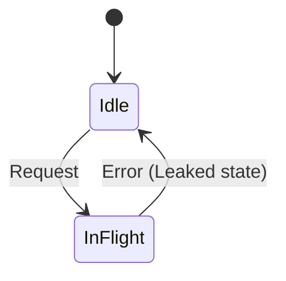

# Deep Audit: First-Principles Codebase Hardening & Optimization

> *"Your app already has a formal semantics. You just haven't met it."* — renders  
> *"Caching is cope for a slow design. Do not add caches and delete all existing caches. Redesign it to be faster."* — Jarred Sumner  
> *"Before adding complexity for a speculative or vanishingly unlikely race or security edge case, explain the concrete failure mode, likelihood, and complexity cost to the user and get their buy-in. Do not silently expand scope for theoretical robustness."* — OpenCode `AGENTS.md`

`deep-audit` is a rigorous, adversarial auditing protocol for existing codebases. It rejects band-aids—such as caching over slow algorithms, defensive null-checks over strong invariants, or ad-hoc inline styles over system primitives—in favor of first-principles redesign, explicit state models, and verifiable proof.

---

## 1. Invocation & Mode Triage

The skill can be triggered via slash command, natural language, or explicit flags:

```bash
/deep-audit [target-path] [flags]
```

### Triggering:
- **No flags needed**: You do **not** need to type flags. If you simply run `/deep-audit` or ask *"deep audit this module"*, the skill:
  - Defaults to `--semantic` (the foundational state machine & invariant recovery).
  - Autonomously infers the target lens from your phrasing (e.g., mentioning "speed/allocations/slow" triggers `--perf`, "bloat/defensive code" triggers `--hygiene`, "components/styling" triggers `--ui`).
- **Explicit flags (optional)**: Use flags when you want to force a specific lens or run the entire suite:
  * `--semantic`: Implicit state machines, invariants enforced by hope, desynchronized state, and compensating code.
  * `--perf`: Data-oriented design (DOD), memory layout, lock sharding, hot-path async, and I/O bottlenecks.
  * `--hygiene`: Anti-defensive bloat, making illegal states unrepresentable with ADTs/types, and deleting redundant noise tests.
  * `--ui`: Implicit design system components, layout primitives, and token consolidation.
  * `--all`: Full-spectrum audit executing all five lenses sequentially.

---

## 2. Lens 1: Semantic State & Invariant Recovery
*(Ruiz, renders, Chow, Puckett, Chen)*

### Core Prompt Directives
1. **Recover the Minimal Semantic Model**:
   * **State**: What values actually change what the caller or user observes?
   * **Transitions**: Which operations commute? Which are idempotent? Which are strictly order-dependent?
   * **Dependencies**: What predicates *must* be true before each side-effect fires?
2. **Find Hidden State Hazards**:
   * **Nondeterminism**: Unbounded concurrency in `await`s, event loop ordering, retries, and network delays.
   * **Invariants Enforced by Hope**: Implicit assumptions relying on convention rather than runtime or type enforcement (e.g., `current_step <= total_steps`, single-flight submissions, non-reentrant handlers).
   * **Drifting Truth**: One factual entity stored in multiple places without an authoritative single source.
   * **Dead Execution**: Work computed that never reaches the screen, DB, or caller.
3. **Transition Table Synthesis**:
   * For every implicit state machine uncovered, construct an explicit **State Transition Table** and **Mermaid State Diagram**:
     ```
     [Current State] + [Trigger/Event] -> [Guard/Condition] -> [Next State] + [Side Effects]
     ```
   * Highlight **reachable invalid states**—combinations the code can actually enter via retries, timeouts, or race conditions.

---

## 3. Lens 2: Compensating Code & Accidental Complexity
*(Maze, Wyrmfalls, Viking)*

### Core Prompt Directives
1. **Locate Compensating Code**:
   * Search for defensive code written to tolerate or mask defective upstream behavior:
     * Ad-hoc `null` guards / optional chaining spreading outward from an unvalidated boundary.
     * Re-fetch loops, debounces, or pollers compensating for missing lifecycle events.
     * Reconciliation glue patching two state stores that desynchronized.
2. **First-Principles Invariant Redesign**:
   * For each piece of compensating code, ask:  
     > *"Under what upstream invariant would this code never have been written?"*
   * Propose the architectural seam or invariant change that allows deleting the compensating code entirely.
3. **The Anti-Bloat / Anti-Defensive Rule**:
   * Strip out speculative complexity added for vanishingly unlikely race conditions or hypothetical edge cases.
   * **Rule of Evidence**: Before adding defensive complexity, you must document:
     1. Concrete reproducible failure mode.
     2. Real-world likelihood.
     3. Long-term complexity cost.
   * If there is no proof of failure, delete the defensive bloat.

---

## 4. Lens 3: Systems & Data-Oriented Performance
*(Sumner, Konstantopoulos, Garcia, Drenova)*

### Core Prompt Directives
1. **Zero-Cope Caching**:
   * Treat caching as an admission of flawed algorithms or poor data layout.
   * Reject adding caches. Review existing caches and evaluate whether redesigning data structures makes them unnecessary.
2. **Data-Oriented Design (DOD) & Memory Layout**:
   * **Flat Arrays & Bit Packing**: Replace pointer-heavy maps/hash tables with contiguous flat arrays. Represent pointers as indices; pack hot flags into unused upper bits.
   * **SoA vs. AoS**: Convert Arrays of Structures (AoS) to Structures of Arrays (SoA) when operations scan single fields across entities.
   * **Bitsets**: Replace arrays of booleans or multiple enum flags with compact bitsets.
   * **Stack vs. Heap**: Replace heap-allocated dynamic lists with stack-allocated inline capacity (e.g., `SmallVec`, fixed-size buffers) for typical sizes.
3. **Concurrency & Contention**:
   * Shard locks across hash keys or stripes to eliminate thread contention.
   * Replace coarse locks with atomic primitives or lock-free queues where uncontended fast paths exist.
   * For mutable shared state under high write load, enforce the **Actor / Message-Passing pattern with explicit bounded backpressure**.
4. **Hot Paths & I/O Pruning**:
   * **Async Waterfalls**: Scan hot paths for sequential `await`s that can be run concurrently (`Promise.all` / `join_all`).
   * **Static Lifting**: Hoist dynamic regex compilation (`RegExp`, `Regex::new`) and URL parsing out of loops/functions into module-level constants.
   * **Database & Wire**:
     * Eliminate full-row queries (`SELECT *`) where only 2-3 fields are read.
     * Identify hot-path queries extracting single keys from large JSONB columns; promote them to native typed columns to eliminate PostgreSQL detoasting overhead.

---

## 5. Lens 4: Implicit Design System Extraction
*(Rody Davis)*

### Core Prompt Directives
1. **Audit UI Surfaces**:
   * Scan component trees for duplicate inline styles, divergent margin/padding values, and arbitrary raw hex colors.
   * Identify recurring structural shells (dialogs, cards, action bars, list items) implemented as copy-pasted layout divs.
2. **Consolidation**:
   * Map discovered variants into an explicit token scale (spacing, typography, elevation, color tokens).
   * Refactor repeated layouts into single canonical component primitives with typed variants.

---

## 6. Lens 5: Verifiable Execution & Decision Contracts
*(Ash Hart, Malix_Labs)*

### Core Prompt Directives
1. **Type-Level Defense**:
   * Replace loose types with Algebraic Data Types (tagged unions, enums with payloads).
   * Enforce affine/linear transitions (where consuming a state token invalidates the previous state), making invalid transitions compile-time impossibilities.
   * Prune duplicate unit tests that only verify what the type checker already proves.
2. **Refactor Classification: "Provably Equivalent" vs. "Trust Me"**:
   * Every refactor recommendation must be classified into one of two buckets:
     * **Provably Equivalent**: Pure structural refactoring preserving exact operational semantics.
     * **Trust Me**: Behavioral alterations or semantic tightening.
   * **The "Trust Me" Requirement**: For every "trust me" recommendation, provide the **minimal input or test case that breaks the existing code or exposes the divergence**.
3. **Actionable Delivery**:
   * Show the failing repro/test first.
   * Apply the minimal surgical diff.
   * Report exact commands executed and cite output proving zero regressions.

---

## 7. Deliverable Report Template

When `/deep-audit` runs, it outputs findings strictly in this format:

```markdown
# Deep Audit Report: <Target Module/Component>

## 1. Executive Summary & Semantic Model
- **Observed State Variables**: <list>
- **Implicit State Machines Found**: <summary>
- **Invariants Enforced by Hope**: <summary>

## 2. State Machine Transitions & Reachable Bugs
| Machine | Current State | Event | Next State | Reachable Invalid States & Hazards |
|---|---|---|---|---|
| AuthFlow | AwaitingSMS | ResendClick | PendingSMS | Double submit via race; timer desync |



## 3. Compensating Code & Anti-Bloat Removals
- **Workaround Found**: <path/line>
- **Root Invariant Missing**: <explanation>
- **Action**: Delete patch; enforce upstream invariant via <types/guards>.
- **Speculative Complexity Removed**: <unnecessary defensive wrappers stripped>.

## 4. Systems Performance & Data-Oriented Optimization
- **Data Layout / Memory**: <AoS -> SoA, Flat array, Bitset refactors>
- **Concurrency & Locking**: <Lock sharding, Actor backpressure, Lock-free updates>
- **Hot-Path I/O**: <Async waterfall elimination, DB column promotion, Regex hoisting>

## 5. Proposed Changes: Provably Equivalent vs. Trust Me
### Provably Equivalent
- `<description + exact file seam>`

### Trust Me
- `<description>`
  - **Minimal Breaking Input**: `<repro input or concurrency race>`
  - **Verification Test**: `<test code>`
```
